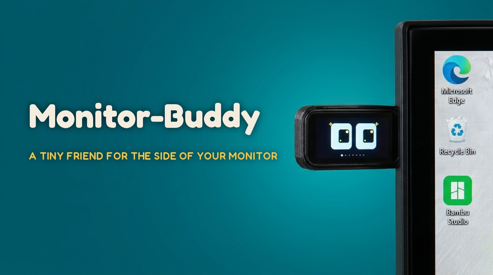
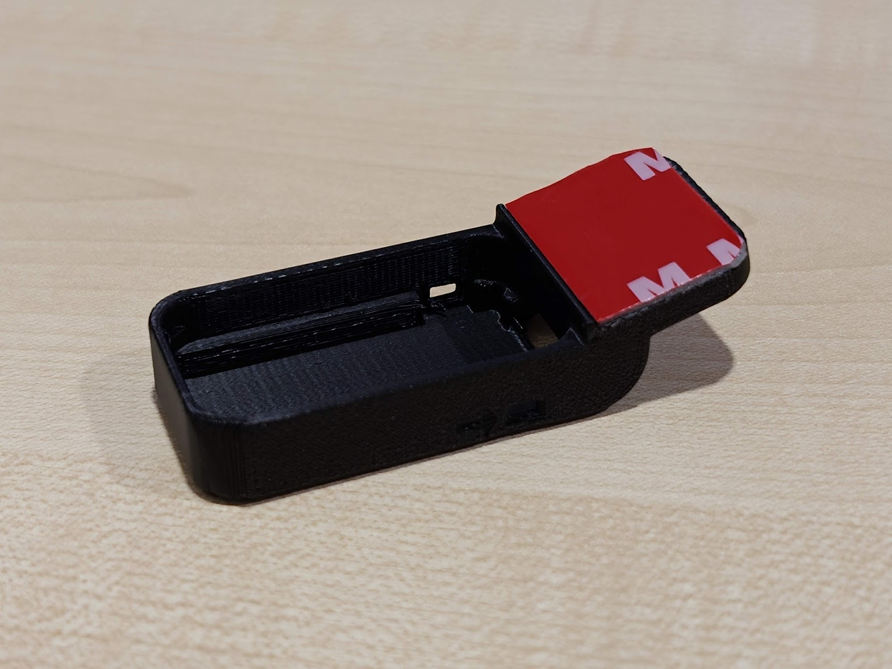
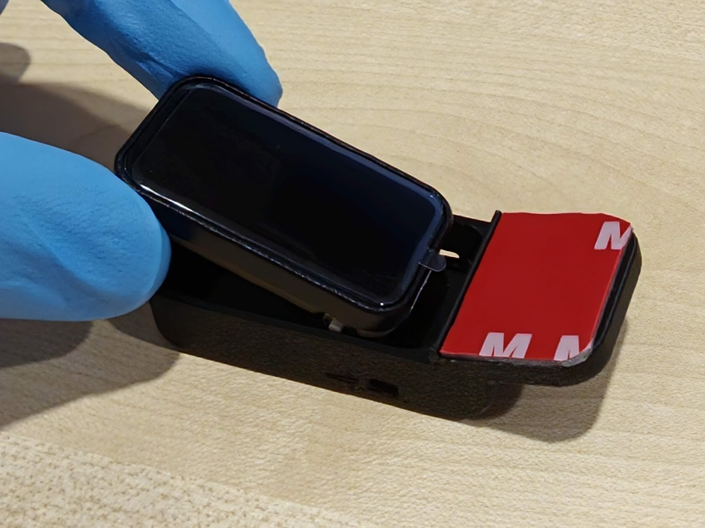
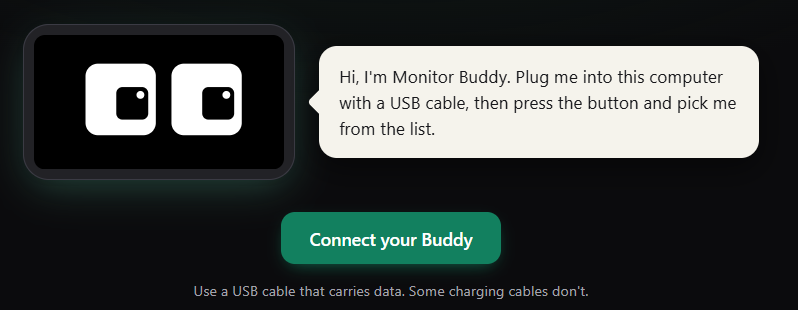
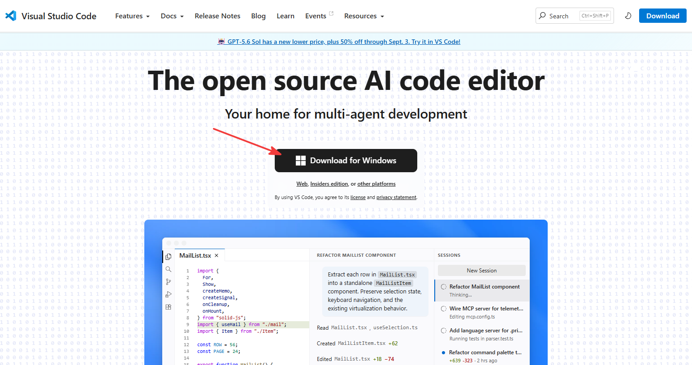
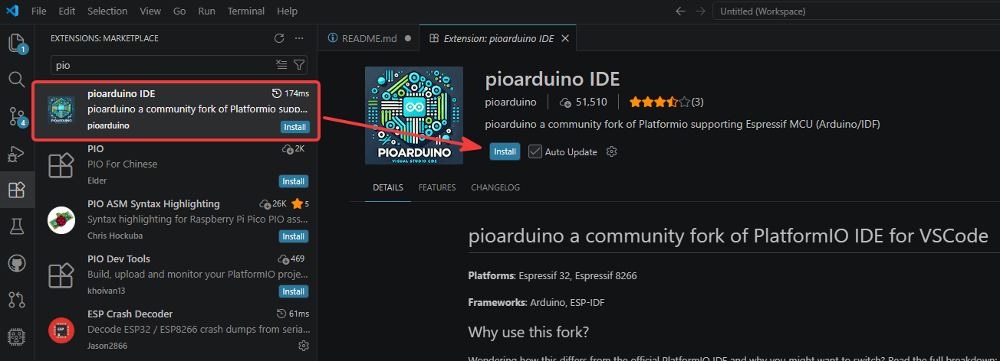
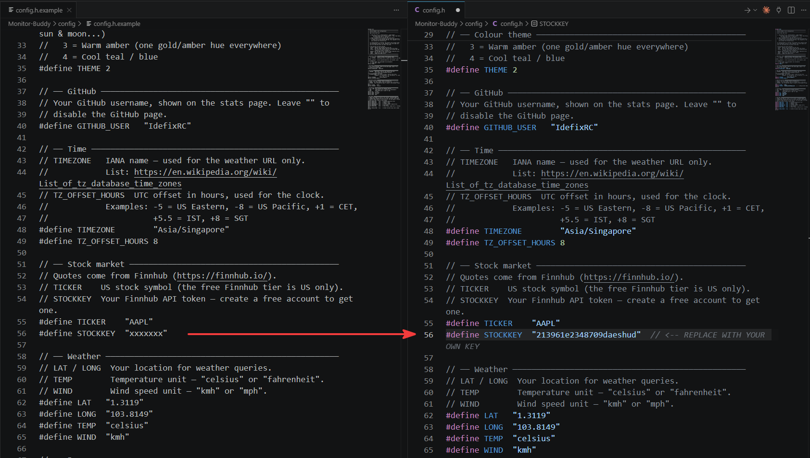
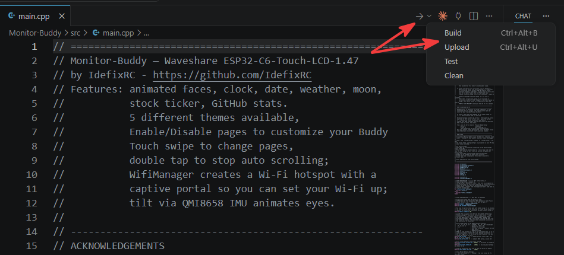
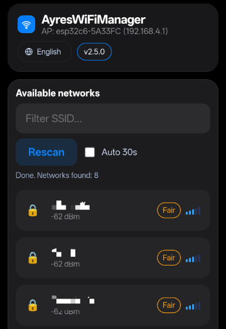

# Monitor-Buddy

**A tiny friend for the side of your monitor.** It pulls faces at you, follows your movements with its eyes, and in its spare time tells you the weather, the date, the moon phase, your stock ticker, and your GitHub stats.

<!-- SHOT: hero.jpg - Monitor-Buddy clipped to the right edge of a monitor, screen showing the animated face, taken slightly from the side so you can see the printed holder -->

---

## 1. Meet Monitor-Buddy

Your monitor has a bezel. That bezel is doing nothing. Monitor-Buddy fixes that.

It is a small touchscreen that clips onto the edge of your screen and keeps you company while you work. Most of the time it just shows a face: it blinks, it glances around, and when you pick it up or tilt it, its eyes roll with the motion. Poke the face and it changes expression. It is pointless and you will love it.

It is also genuinely useful when you swipe past the face:

- **Animated face** with several expressions, driven by the on-board QMI8658 motion sensor
- **Clock** and **weekday / date**, kept accurate over NTP
- **Weather** for your location (temperature, conditions, humidity, wind)
- **Moon phase** with illumination percentage
- **Stock ticker** for any US symbol, via a free Finnhub account
- **GitHub stats** for your username
- **5 colour themes**, from plain white-on-black to a green-up / red-down semantic theme
- **Toggle any page on or off** so your Buddy only shows what you care about
- **Left or right side** of your monitor: one setting turns the screen, touch and eye movement around for a right-side mount
- **Swipe** left and right to move between pages, up and down to adjust brightness (remembered across restarts), **double-tap** to stop the auto-scroll, **tap the face** to change expression (all controls in [4.10](#410-everyday-controls))
- **Stays smooth on bad Wi-Fi**: weather, stock and GitHub data load in the background, so the face and touch never wait for the network
- **Set up from your browser**: the [web flasher](https://idefixrc.github.io/Monitor-Buddy/) installs the firmware over USB and writes your settings straight onto the board, with a live preview of your Buddy. No software to install, no code to edit.
- **Wi-Fi setup with no code**: Monitor-Buddy runs its own hotspot with a captive portal. Join it from your phone, pick your network, done. The setup page follows your phone's language (English, Spanish or German).

The whole thing is a **cheap Waveshare ESP32-C6 touchscreen** and **one 3D-printed clip**. **No soldering**, no breadboard, and no wiring required. You print the holder, slide the board in, and plug in a USB-C cable and Monitor-Buddy is ready to rock.

---

## 2. What you need

| Item                                                                          | Quantity | Where                                                                |
| ----------------------------------------------------------------------------- | -------- | -------------------------------------------------------------------- |
| 3D-printed holder: `Monitor-Buddy_flat.STL` **or** `Monitor-Buddy_recess.STL` | 1        | [MakerWorld](https://makerworld.com/en/models/3241960-monitor-buddy) |
| Waveshare ESP32-C6-Touch-LCD-1.47                                             | 1        | [AliExpress](https://s.click.aliexpress.com/e/_c33mPWKx)             |
| USB-C cable (power and flashing)                                              | 1        | [AliExpress](https://www.aliexpress.com/item/1005008819293735.html)  |

**IMPORTANT:** Please make sure you purchase the touchscreen version of the ESP-32-C6  (see link above). Non-touchscreen versions are smaller and will not fit the holder. In addition, the code will not work as intended **!!**

You also need a computer with **Chrome or Edge** to flash the board once. After that the USB-C cable is only for power, so any charger or a spare USB port on the monitor will do.

Nothing else. No resistors, no headers, no hot glue.

---

## 3. Assembly

### a) Print the holder

There are two versions of the mount. Pick one:

- **`Monitor-Buddy_flat.STL`** has a flat back. Stick it to the side of your monitor with a strip of ordinary double-sided tape.
- **`Monitor-Buddy_recess.STL`** has a recess sized for **3M Dual Lock** tape. Use this one if you want to be able to pull the Buddy off and put it back without peeling anything.

PLA or PETG is recommended. Only minor supports needed.

Both versions work on either side of your monitor: for the right side, mount the holder turned upside down and choose **Right** as the mounting side in the web flasher (or set `MOUNTING_LOCATION` to `RIGHT` if you build it yourself, see [4.5](#45-personalize-your-buddy)) so the screen reads the right way up.

### b) Slide the board into the holder

The Waveshare board slides straight into the printed part and is held by friction. No glue, no screws.

### c) Flash the board

Open the [web flasher](https://idefixrc.github.io/Monitor-Buddy/) and follow [chapter 4](#4-flashing-the-board) below. You only do this once.

### d) Apply power and enjoy your new monitor friend

Plug in the USB-C cable. If you gave it your Wi-Fi in the web flasher, it connects straight away. With no Wi-Fi configured, it opens its setup hotspot instead (see [4.9](#49-first-boot-connect-it-to-wi-fi)).

If you print one, **post a picture of your build on MakerWorld**, and if the model saved you some time, a like or a boost is appreciated. 🙏

---

## 4. Flashing the board

There are two ways to get the firmware onto your Buddy. The **web flasher** does it from your browser in a couple of minutes and is the right choice for almost everyone. **Building it yourself** (4.1 to 4.8) is for when you want to change the code.

### The web flasher (recommended)

The **[Monitor-Buddy web flasher](https://idefixrc.github.io/Monitor-Buddy/)** installs the firmware over USB and writes your settings straight onto the board. No VS Code, no `config.h`, nothing to install.

You need **Chrome or Edge on a computer** (Windows, macOS, Linux or ChromeOS). The page talks to the board through Web Serial, which Firefox, Safari and phone browsers don't have.

1. Plug the Buddy into the computer with a USB-C cable that carries data.
2. Open <https://idefixrc.github.io/Monitor-Buddy/>, click **Connect your Buddy** and pick the Buddy from the list (on Windows it has a COM port number).
3. Choose what to do:
   - **A new Buddy:** **Fresh install**. Tell it where it is with the city search, which fills in the latitude, longitude and time zone (daylight saving included). Add your Wi-Fi, pick the pages, the theme and the mounting side, then **Install**.
   - **A Buddy you built yourself with 1.1.0 or older:** **Upgrade from 1.1 or older**, then **Import config.h** to bring your old settings across. Your Wi-Fi stays as it is.
   - **A Buddy on 1.2.0 or newer:** **Change settings**, **Update firmware**, **Back up settings** to a file (and import it again later), **Fresh install** or **Reset to defaults**. Nothing needs rebuilding, ever.
4. While you change things, the preview on the page shows how your Buddy will look. When you save or install, the Buddy restarts with your settings.

Your settings go straight to the Buddy. The page stores nothing in your browser, and the only requests that leave your computer are the city search (Open-Meteo) and the **Check** buttons, which ask Finnhub and GitHub whether your stock key and username work.

If an install gets interrupted, say the cable came out halfway, the Buddy can't start any more. That sounds worse than it is: connect it again and the page notices, offers **Install the firmware again**, and keeps the settings that were already on the board. If the page ever says it couldn't get ready for the install, unplug the Buddy, plug it back in and click **Try again**. The web flasher never needs the BOOT or RESET buttons.

---

### Building it yourself

This guide assumes you have never used VS Code or pioarduino. It is written for **Windows**, with notes for **macOS** and **Linux** where they differ. It takes about 20 minutes the first time, most of which is software downloading in the background.

The board is a **Waveshare ESP32-C6-Touch-LCD-1.47**. The ESP32-C6 is new enough that it needs the **pioarduino** build platform, a community fork of the standard ESP32 tooling. The steps below install everything.

### 4.1 Install VS Code

1. Go to <https://code.visualstudio.com/>.
2. Download the build for your OS and run the installer.
3. On Windows, accept the defaults. Ticking "Add to PATH" is helpful but not required.

Launch VS Code when it finishes.

### 4.2 Install the pioarduino IDE extension

1. Click the **Extensions** icon in the left sidebar (the four-squares icon), or press `Ctrl+Shift+X`.
2. Search for **`pioarduino`**.
3. Install the **pioarduino IDE** extension.
4. Wait for it to finish setting up. It downloads a Python environment and its core tooling in the background, which can take a few minutes. A **pioarduino** bar appears along the bottom of the window when it is ready.

> **Already have the official PlatformIO extension?** It also works with this project, because the pioarduino platform is pulled in by URL from `platformio.ini`. If you are starting fresh, use the pioarduino extension. It tracks new Espressif chips more closely.

> **macOS / Linux:** identical. The extension installs its own Python environment, so you do not need to install Python yourself.

### 4.3 Get the Monitor-Buddy code

1. Open the [**latest release**](https://github.com/IdefixRC/Monitor-Buddy/releases/latest).
2. Under **Assets**, download the **`Monitor-Buddy-<version>.zip`** file (for example `Monitor-Buddy-1.0.1.zip`). It contains only the files needed to build and flash, nothing else.
   From 1.2.0 on, each release also has a ready-made firmware file, `monitor-buddy-<version>.bin`. That's the file the web flasher installs.
3. Extract it somewhere permanent, for example `Documents\Monitor-Buddy`. Do not run it from inside the ZIP or from your Downloads folder.

> Prefer Git? `git clone https://github.com/IdefixRC/Monitor-Buddy.git` works too. You just get the full repo (docs, screenshots, CI) alongside the code.

### 4.4 Open the project

1. In VS Code: **File > Open Folder**, and select the `Monitor-Buddy` folder (the one that contains `platformio.ini`).
2. If VS Code asks whether you trust the authors, say yes.
3. The first time you open it, pioarduino reads `platformio.ini` and downloads the pioarduino platform, the ESP32-C6 toolchain, and the libraries this project uses (`Arduino_GFX`, `ArduinoJson`, `AyresWiFiManager`). This is a large download, several hundred MB, and only happens once.

Wait until the terminal activity stops before moving on.

### 4.5 Personalize your Buddy

One file to touch: `config/config.h`. It is plain text, edit it right inside VS Code.

**a) Create your config file**

1. In the VS Code file explorer, open the `config` folder and find `config.h.example`.
2. Right-click it, **Copy**, then **Paste** into the same `config` folder. Rename the copy to `config.h`.
3. `config/config.h` is gitignored on purpose: it holds your Finnhub API key, so it never gets committed. `config.h.example` is the only config file tracked by git.

**b) Edit your settings**

Open `config/config.h` and change these `#define` lines:

| Setting                        | What to put                                                                                                                   |
| ------------------------------ | ----------------------------------------------------------------------------------------------------------------------------- |
| `MOUNTING_LOCATION`            | `LEFT` or `RIGHT`, the side of the monitor your Buddy is mounted on                                                           |
| `THEME`                        | `0` to `4`, see the comments above the line                                                                                   |
| `GITHUB_USER`                  | your GitHub username to show the GitHub page; `""` (the default) hides it                                                     |
| `TIMEZONE`                     | your IANA timezone name, for example `"Europe/Berlin"` ([list](https://en.wikipedia.org/wiki/List_of_tz_database_time_zones)) |
| `TZ_OFFSET_HOURS`              | your offset from UTC in hours, for example `1` for CET, `-5` for US Eastern                                                   |
| `TICKER`                       | a US stock symbol, for example `"AAPL"`                                                                                       |
| `STOCKKEY`                     | your free Finnhub API key from <https://finnhub.io/> to show the stock page; `""` (the default) hides it                      |
| `LAT` / `LONG`                 | your latitude and longitude for weather                                                                                       |
| `TEMP` / `WIND`                | `"celsius"` or `"fahrenheit"`, `"kmh"` or `"mph"`                                                                             |
| `SHOW_FACE`, `SHOW_CLOCK`, ... | `true` or `false` to enable or disable each page                                                                              |
| `TZ_RULE`                      | optional, a POSIX time zone rule with daylight saving; `""` uses `TZ_OFFSET_HOURS`                                            |

Save the file (`Ctrl+S`).

Don't care about stocks? Leave `STOCKKEY` as `""` and the stock page stays hidden. Enter your key to show it. The same goes for `GITHUB_USER`: empty hides the GitHub page. You can also switch the page off with `SHOW_STOCK false`. If you skip creating `config/config.h` entirely, the build falls back to the defaults in `config.h.example`.

**Settings saved on the board win.** From firmware 1.2.0 on, the Buddy can also keep its settings on the board itself, in `/config.json`. The web flasher saves them there, and so does `tools/mb_serial.py`. Once they're saved, `config/config.h` only fills in settings the board doesn't have, so editing it and uploading again changes nothing that's already saved. To change a saved setting, use the web flasher's **Change settings**, or the tool, for example `python tools/mb_serial.py COM4 set ticker=AVGO` (use your board's port instead of `COM4`; `get` shows what is saved). To delete the saved settings, run `python tools/mb_serial.py COM4 defaults`: the Buddy restarts on your `config.h` values and keeps its Wi-Fi and brightness. The tool needs Python 3 and one package: `pip install pyserial`. The setup page's erase also deletes the saved settings, and the Buddy goes back to your `config.h` values, but it clears the Wi-Fi and brightness too.

Want daylight saving? Set `TZ_RULE` to a POSIX time zone rule, for example `"CET-1CEST,M3.5.0,M10.5.0/3"` for Central Europe. Left empty, the clock uses the fixed `TZ_OFFSET_HOURS`.

### 4.6 Plug in the board

Connect the Waveshare board to your computer with the USB-C cable.

- **Windows 10 / 11:** the board uses the ESP32-C6's built-in USB, so it usually appears with no driver install. If Device Manager shows an unknown device, install the Espressif USB-JTAG/serial driver from <https://github.com/espressif/esp-usb-jtag>.
- **macOS:** no driver needed. The port shows up as `/dev/cu.usbmodemXXXX`.
- **Linux:** no driver needed. The port is usually `/dev/ttyACM0`. If uploads fail with a permissions error, add yourself to the `dialout` group: `sudo usermod -aG dialout $USER`, then log out and back in.

pioarduino detects the port automatically. You do not normally need to select it by hand.

### 4.7 Build and upload the firmware

Along the top bar of VS Code, pioarduino adds a row of small icons:

1. Click the **checkmark (Build)** first. This compiles the project. The first build takes a few minutes. It ends with `SUCCESS`.
2. Click the **right-arrow (Upload)**. This flashes the firmware onto the board. The screen goes dark for a moment and then the Buddy starts up.

If the upload can't find or open the board, close any serial monitor that is open on it (the pioarduino monitor holds the port too), unplug the Buddy, plug it back in and click Upload again. The board switches into upload mode by itself, so you never need the BOOT button for this. If an upload got cut off and the Buddy no longer starts, the [web flasher](#the-web-flasher-recommended) reinstalls it and keeps your saved settings.

### 4.8 Updating to a new version

With the web flasher, connect your Buddy and choose **Update firmware**. Your settings and Wi-Fi stay on the board. Built it yourself? Then:

1. Download and extract the new release as in [4.3](#43-get-the-monitor-buddy-code), into a new folder.
2. Copy your `config/config.h` from the old folder into the new one.
3. Open the new folder and click **Upload** as in [4.7](#47-build-and-upload-the-firmware).

Coming from 1.1.0 or older? Your `config.h` keeps working as it is. You can also switch to the web flasher now: **Upgrade from 1.1 or older** imports your `config.h` and keeps your Wi-Fi, and from then on you never rebuild to change a setting. A `TZ_RULE` line is new and optional; without it the clock works as before, except that half-hour zones such as India (+5.5), which 1.1.0 cut down to whole hours, are now correct.

Your saved Wi-Fi and brightness stay on the board, so the Buddy reconnects by itself after the update. Coming from 1.0.2 or older? The old setup page is removed on the first start, and from then on the setup page follows your phone's language.

### 4.9 First boot: connect it to Wi-Fi

If you entered your Wi-Fi in the web flasher, the Buddy is already connected and you can skip this. With no Wi-Fi configured, the Buddy starts its own hotspot at power-on.

1. On your phone or laptop, join the Wi-Fi network **`Monitor-Buddy-Setup`**, password **`buddy1234`**.
2. A setup page should open by itself. If it does not, open a browser and go to **`http://192.168.4.1`**.
3. Pick your home network, enter its password, and save.
4. The Buddy reboots and connects. The clock, weather, and other pages fill in within a few seconds.

To change the Wi-Fi later, **press and hold anywhere on the touchscreen for about 3 seconds**. The setup hotspot comes back.

### 4.10 Everyday controls

| Do this                                         | What happens                                                                                     |
| ----------------------------------------------- | ------------------------------------------------------------------------------------------------ |
| Swipe left / right                              | Next / previous page                                                                             |
| Swipe up / down                                 | Brighter / dimmer. Keep dragging for bigger steps. The level is remembered across restarts.      |
| Tap the face                                    | Change the expression                                                                            |
| Double-tap                                      | Stop or restart the automatic page scrolling                                                     |
| Tilt or move the Buddy                          | The eyes follow the motion                                                                       |
| Hold the screen still for about 3 seconds       | Open the Wi-Fi setup hotspot. Hold again for 3 seconds to close it.                              |
| **Factory reset**: open the Wi-Fi setup page (hold the screen for 3 seconds) and press **erase** | Erases Wi-Fi, brightness and board settings. Restarts into Wi-Fi setup on its built-in values.    |

The board also has a **BOOT** button, next to **RESET**. Check the labels, because RESET just restarts the Buddy. BOOT only counts in a short window while the Buddy starts up, not while it is running. Unplug and plug back in, and as soon as the screen shows **CONNECTING** (or **WIFI SETUP**), press BOOT within 2 seconds:

- **Hold 2 to 5 seconds**: opens the Wi-Fi setup hotspot.
- **Hold 5 seconds or more**: forgets the saved Wi-Fi and restarts into Wi-Fi setup. Brightness and the settings saved on the board are kept. To erase those as well, use **erase** on the setup page; the Buddy then goes back to its built-in `config.h` values.

Don't hold BOOT while plugging in: that starts the chip's download mode instead. The screen stays dark, and the computer sees a different device on a new port (on Windows, a new COM number) instead of your Buddy. Unplug it and plug it back in without touching BOOT.

The built-in values are the release defaults, or your `config/config.h` settings if you built the firmware yourself, so a factory reset doesn't touch them. To reset only the settings and keep the Wi-Fi and brightness, use **Reset to defaults** in the web flasher.

### 4.11 Troubleshooting

| Symptom                                           | Fix                                                                                                                                                                                                                                                                                                                                           |
| ------------------------------------------------- | --------------------------------------------------------------------------------------------------------------------------------------------------------------------------------------------------------------------------------------------------------------------------------------------------------------------------------------------- |
| The web flasher doesn't list the Buddy            | Use Chrome or Edge on a computer, and a USB-C cable that carries data (many are charge-only). Close any program that has the port open, such as a serial monitor in VS Code, then unplug the Buddy and plug it back in. On Windows, check Device Manager for an unknown device and install the driver linked in [4.6](#46-plug-in-the-board). |
| The Buddy stays dark after an interrupted install | Its firmware didn't finish installing. Connect it in the web flasher and choose **Install the firmware again**. The settings saved on the board stay.                                                                                                                                                                                         |
| No port shown / Upload can't find the board       | Try a different USB-C cable. Many are charge-only. On Windows, check Device Manager for an unknown device and install the driver linked in [4.6](#46-plug-in-the-board).                                                                                                                                                                      |
| Upload starts then fails                          | Close any serial monitor on the port, unplug the Buddy, plug it back in and click Upload again. If it no longer starts, reinstall it with the web flasher; your saved settings stay.                                                                                                                                                          |
| Clock or weather never updates                    | Wi-Fi did not connect. Set it in the web flasher's **Change settings**, or hold the screen for 3 seconds and redo the setup. Then check the location and time zone there too. Built it yourself without saved settings? Check `TZ_OFFSET_HOURS` and `TZ_RULE` in `config/config.h` and flash again.                                           |
| Screen is upside down                             | Your Buddy is mounted on the other side. Change the **Mounting side** in the web flasher's **Change settings**. Built it yourself? Set `MOUNTING_LOCATION` to `LEFT` or `RIGHT` in `config/config.h` and flash again; settings saved on the board win, so change those in the web flasher or with the tool (`set mount=right`).               |
| Screen too dark to read                           | Swipe up a few times to raise the brightness, or press **erase** on the setup page (clears the board settings too; see [4.10](#410-everyday-controls)).                                                                                                                                                                                       |
| Stock page is missing or blank                    | No stock page: an empty Finnhub key hides it, so enter your key in the web flasher's **Change settings** and press **Check** (built it yourself: `STOCKKEY` in `config/config.h`). Blank page: wrong key, or not a US stock (the free Finnhub tier is US only).                                                                               |
| Build fails mentioning `ArduinoJson`              | Deprecation _warnings_ from `ArduinoJson` are expected and harmless. Only a red `error` is a real problem.                                                                                                                                                                                                                                    |

---

## Acknowledgements

Monitor-Buddy builds on the work of others:

- **[schematik.io](https://schematik.io/)** Tiny ESP DeskBuddy, the starting-point idea.
- **[EDISON-SCIENCE-CORNER / DESKBUDDY-1.0](https://github.com/EDISON-SCIENCE-CORNER/DESKBUDDY-1.0)** for additional face designs.
- **[AyresWiFiManager](https://github.com/ayresnet/AyresWiFiManager)** for the captive-portal Wi-Fi setup. Monitor-Buddy uses the [IdefixRC fork](https://github.com/IdefixRC/AyresWiFiManager), which adds Arduino core 3.x support, the multilingual setup page and a time sync that never blocks.
- **[esptool-js](https://github.com/espressif/esptool-js)** by Espressif (Apache-2.0), which the web flasher uses to write the firmware from the browser.
- **[posix_tz_db](https://github.com/nayarsystems/posix_tz_db)** (MIT) for the time zone rules, daylight saving included.
- **[Open-Meteo](https://open-meteo.com/)** for the weather and the web flasher's city search.

Contributors:

- **[AmyJoT](https://github.com/AmyJoT)** for the brightness swipe, a sturdier touch read and the first network changes that keep the UI responsive ([#3](https://github.com/IdefixRC/Monitor-Buddy/pull/3)).

## License

MIT. See [LICENSE](LICENSE).
